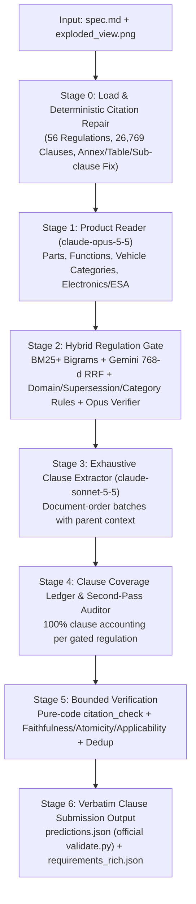

# Architecture Overview (`docs/ARCHITECTURE.md`)

## Module Responsibilities

- [`certi/stages/stage0_load.py`](../certi/stages/stage0_load.py): Loads `data-ingestion/clauses/*.json` and `regulations/index.json`; deterministically repairs false tabular `Annex N` transitions, attaches `Table N` captions to their enclosing paragraphs, and extracts verbatim sub-clause text (`sub_paragraph_texts`).
- [`certi/llm.py`](../certi/llm.py): Thread-safe, disk-cached Anthropic Messages API (`output_config.format = json_schema`) and Gemini Embedding client keyed by `sha256(model + prompt_version + rendered_input)`.
- [`certi/retrieval.py`](../certi/retrieval.py): Hybrid BM25+ (with bigrams) and precomputed `gemini-embedding-2-preview` (768-d) retriever combined via Reciprocal Rank Fusion (`k0=60`) with deterministic tie-breaking (`np.lexsort`).
- [`certi/stages/stage1_product_reader.py`](../certi/stages/stage1_product_reader.py): Multimodal spec + drawing inventory.
- [`certi/stages/stage2_gate.py`](../certi/stages/stage2_gate.py): Hybrid candidate selection, supersession/category filtering, and Claude Opus gate verification (`runs/<id>/gate.json`).
- [`certi/stages/stage3_extract.py`](../certi/stages/stage3_extract.py): Exhaustive document-order clause extraction and Stage 4 coverage ledger (`runs/<id>/stage4_ledger.json`).
- [`certi/stages/stage5_verify.py`](../certi/stages/stage5_verify.py): Pure-code citation check/repair, batched bounded LLM verifier (`KEEP | FIX | SPLIT | DROP`), verbatim clause projection, and official `validate.py` verification.
